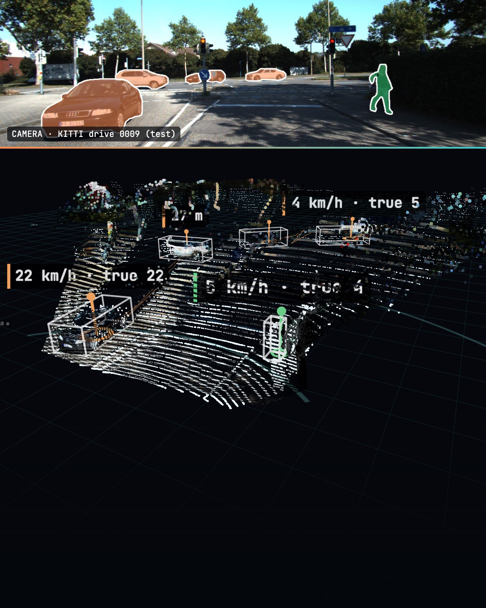
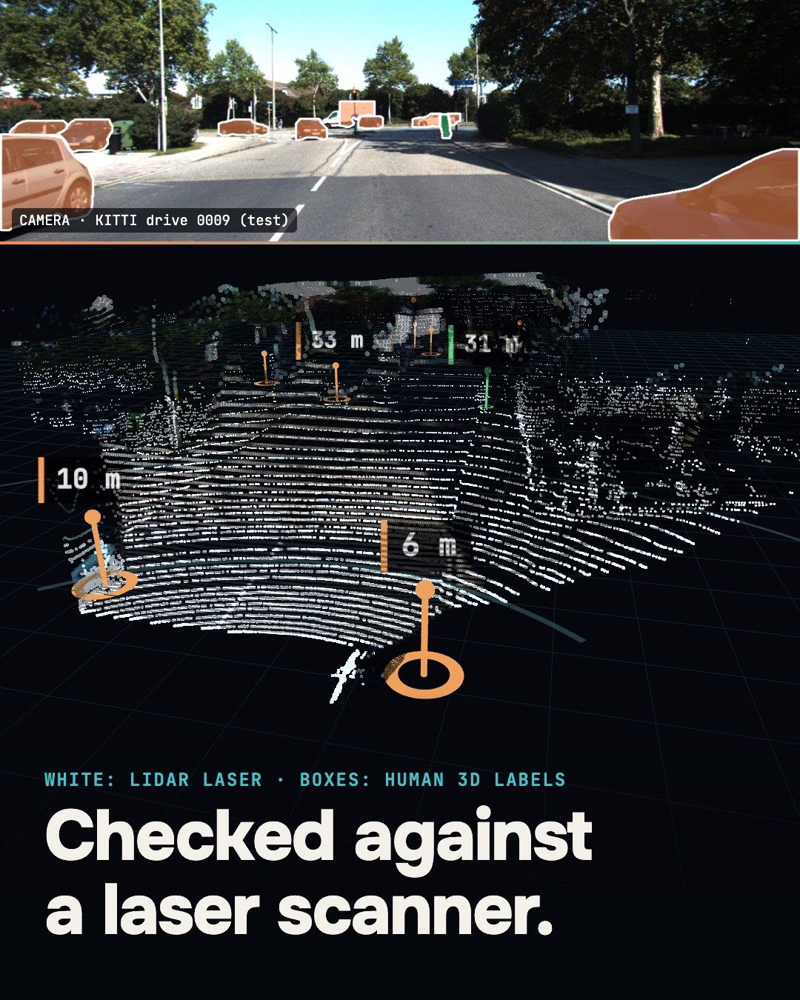
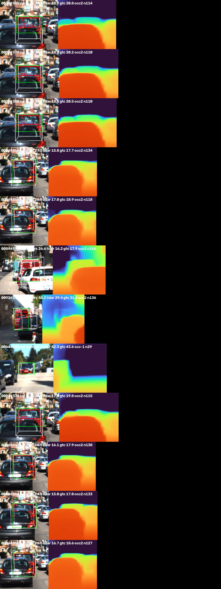

# metric3d

**One camera, every car in metres: 3D position and speed from Ultralytics YOLO26 seg + depth, checked against LiDAR.**

[YOLO26-depth](https://github.com/ultralytics/ultralytics/issues/25695) gives a metric distance for every pixel from a
single camera. This repo tests what that buys downstream. With YOLO26-seg and no extra sensor, can we say *where* each car
is in metres and *how fast* it moves?

We measured it on KITTI raw drives the depth model never saw, against the laser scanner and the human 3D labels,
in one pre-registered test run. Every number is reported, including where it breaks.



*KITTI test drive 0009. Top: the camera with YOLO26x-seg masks. Bottom: the frame lifted into metric 3D by
YOLO26x-depth. Pins are our ground positions; `22 km/h · true 22` is our speed next to the speed from the human 3D labels
(white boxes).*

## Result in one paragraph

**Setup:**
- Detector + tracker: Ultralytics YOLO26x-seg + ByteTrack.
- Depth: Ultralytics YOLO26x-depth (metric output, no calibration).
- Both run as TensorRT FP16 engines.
- No training and no fine-tuning.

**Test result (11 held-out KITTI drives, 523 car tracks, 15,181 measurements):**
- **Car position error: 1.23 m** median (95% CI 1.12–1.35), against 2.03 m for classic camera geometry.
  The CI of the difference is [−0.97, −0.65] m, entirely below zero, so the main pre-registered hypothesis passed.
- **Car speed error: 1.7 km/h** median, against 3.0 km/h for classic geometry.
  The difference CI is [−1.84, −0.73] km/h, so this hypothesis passed too.
- **Camera height:** found from the road in the depth map, with no calibration.
  Median over test frames 1.71 m (p10–p90 1.64–1.78 m); the true height is 1.65 m.
- **Latency: 23.5 ms per frame** (p95 25.0 ms) on one RTX 5060 Ti.



## Method

For each frame:
1. **Segment and track** cars and people: YOLO26x-seg (conf 0.25, imgsz 640) with ByteTrack.
2. **Predict metric depth** with YOLO26x-depth (Ultralytics default letterbox, imgsz 768).
3. **Find the road.** RANSAC fits a plane to depth-map pixels below the horizon and outside all masks.
   The plane gives the camera height and the ground, so no camera height is assumed.
4. **Place each car on the ground** (`hybrid`):
   - Cast a ray through the bottom centre of its box and intersect it with the road plane.
   - Use that contact point when it is closer than 40 m and agrees with the mask depth within 50%.
     Otherwise use the median depth of the mask.
     This covers occluded box bottoms and boxes cut by the frame edge.
   - Push the visible-surface point back along the horizontal viewing ray by r = 1.25 m to reach the car's centre.
5. **Measure speed.** Fit Theil–Sen to 3 s of world positions; a car counts as "moving" above 5 km/h.
   Our own car's motion comes from the KITTI GPS/IMU (OXTS) poses.
   That sensor is used only to cancel ego-motion, never to locate other cars.

**Baselines:**
- `B0`, classic geometry: the bottom of the box on a flat road, with the true camera height of 1.65 m.
- `depth`: mask depth only, without the road plane.
- Reference: Depth Pro 2-L, for depth accuracy only. Its licence is research-only.

## Data and protocol

KITTI raw is part of YOLO26-depth training. Only the 28 Eigen-test drives are excluded, as whole drives
(`depth-kitti.yaml`). Of these, 17 have 3D tracklets. We split them as follows:
- **6 drives for validation:** 0002, 0020, 0029, 0048, 0059, 0086.
  We tuned every parameter on these: the hybrid rule, r per method, the speed window, and letterbox vs stretch input.
- **11 drives for test,** run once after the plan was committed: [`PREREG.md`](PREREG.md).

**Ground truth:**
- LiDAR points inside the labelled 3D box give the distance to the visible surface (M1).
- The KITTI raw 3D tracklets give the car centre (M2) and the speed (M3).
- Bootstrap CIs resample whole tracks.

## Numbers (test)

**M2: car centre on the ground, 0–80 m (median / p90 error, metres)**

| range | n | hybrid | depth | B0 |
|---|---|---|---|---|
| 0–10 m | 2,182 | 0.77 / 1.92 | 0.82 / 1.60 | 1.79 / 4.39 |
| 10–20 m | 4,238 | **0.66** / 1.99 | 1.06 / 2.48 | 1.06 / 3.48 |
| 20–40 m | 6,002 | **1.58** / 4.97 | 1.97 / 5.51 | 2.50 / 9.83 |
| 40–80 m | 2,759 | 5.25 / 14.18 | **4.67** / 13.62 | 6.67 / 22.19 |
| **0–80 m** | 15,181 | **1.23** / 6.36 | 1.44 / 6.23 | 2.03 / 10.12 |

**M3: car speed.** This covers 276 tracks closer than 40 m and 5,691 three-second windows.
69.4% of the windows are stopped cars.

| | median error, km/h | p90 | moving/stopped correct |
|---|---|---|---|
| hybrid | **1.7** [1.4–2.1] | 7.4 | **83.3%** [79.5–86.8] |
| depth | 1.8 [1.5–2.1] | 7.3 | 82.1% |
| B0 | 3.0 [2.3–3.7] | 10.7 | 70.6% (barely above "always stopped", 69.4%) |

**M1: distance to the visible surface vs LiDAR, cars 0–80 m.**
- YOLO26x-depth: abs rel **5.9%** (bias −1.1%), δ<1.25 93.4%.
- Depth Pro 2-L: 5.3%, but with a bias of −4.9%.
- `model.calibrate()`: the Ultralytics selection policy, run on validation, picks a ×0.990 scale. Its effect on test is
  negligible: depth error 6.0% vs 5.9%, centre error 1.24 m vs 1.23 m.

**Latency** (TensorRT FP16, RTX 5060 Ti, 1242×375 frames with objects):
- segmentation + tracker: 8.5 ms;
- depth: 6.7 ms;
- road plane and contact: 8.2 ms, with RANSAC on the CPU as the bottleneck.

**Total: 23.5 ms, about 43 FPS.**

Full tables, in Russian: [`TEST.md`](TEST.md). Raw score files: [`data/`](data/).

## Where it breaks



All 12 worst cases overestimate the distance, by ×1.6–1.9:
- **A dark SUV hidden behind a nearer car.** Only its top is visible, and the street shows through its windows.
  The depth model says 24–37 m; the laser says 15–19 m. This one track is 9 of the 12 worst cases.
- **White vans partly hidden by a nearer car,** one of them against a light wall. Depth roughly doubles.
- **A small car far away at the vanishing point:** 69 m against 42 m.
- **Everything from 40 to 80 m.** All methods have a median centre error of 4.7–6.7 m at this range.
- **People are not verified.** The test drives hold only 4 person tracks, below the pre-registered minimum of 5,
  so we do not claim anything for people.

## Run history (honest log)

- **Test run 1 crashed** on drive 0009 at frame 177. KITTI raw has no LiDAR scans for frames 177–180.
- **The fix:** a missing scan now gives an empty point set, and the run script stops on the first failed step.
  We recorded the fix and its reason in `PREREG.md` before run 2.
  Methods, parameters and the success criterion did not change.
- **Run 2 is the result.** Its rows for 0009 frames 0–176 match run 1 exactly: 1,847 of 1,847.
  Run 1's fragment and logs are kept in [`run1/`](run1/).

## Limitations

- **One setting:** one city, one camera, daytime, dry road.
- **Rough labels:** raw tracklets are rougher than KITTI object labels, and their occlusion flag is often missing.
- **Only what the detector finds:** only detected and matched objects are scored.
- **Few moving cars:** most cars in the speed windows are parked.
- **Imperfect references:** the "true" speed comes from the labels, so it carries their noise.
  The median LiDAR depth only approximates the visible surface.

## Reproduce

The code was run on a Linux PC with an NVIDIA GPU, `ultralytics==8.4.193` and TensorRT engines exported from
`yolo26x-seg.pt` and `yolo26x-depth.pt` (FP16).

```bash
./fetch_kitti.sh                       # 17 KITTI raw drives (image_02, velodyne, oxts) + tracklets, same S3 links as depth-kitti.yaml
python run3d.py --drives 0002 0020 0029 0048 0059 0086 --variant letterbox --out data/val6_letterbox.csv
python score3d.py data/val6_letterbox.csv      # M1, M2, M3 with bootstrap CIs
./test_run.sh                          # the single test run as pre-registered (hashes the code first)
python latency3d.py                    # TensorRT latency, on validation frames only
```

Engine paths are arguments of `run3d.py` (`--det`, `--depth`). The video in `video/` is Remotion + Three.js:
- `video/export.py` replays test drive 0009 with the same engines, tracker and RANSAC seed, and checks every row
  against the test CSV (0 mismatches).
- `video/src/M3D.tsx` renders the result.

## Credits and licence

- **Code:** AGPL-3.0 (see `LICENSE`), as it builds on [Ultralytics](https://github.com/ultralytics/ultralytics).
- **Data:** KITTI raw (Geiger et al., IJRR 2013), CC BY-NC-SA 3.0. No KITTI files are included, only the figures
  derived from them.
- **Speed-up:** NVIDIA TensorRT.
